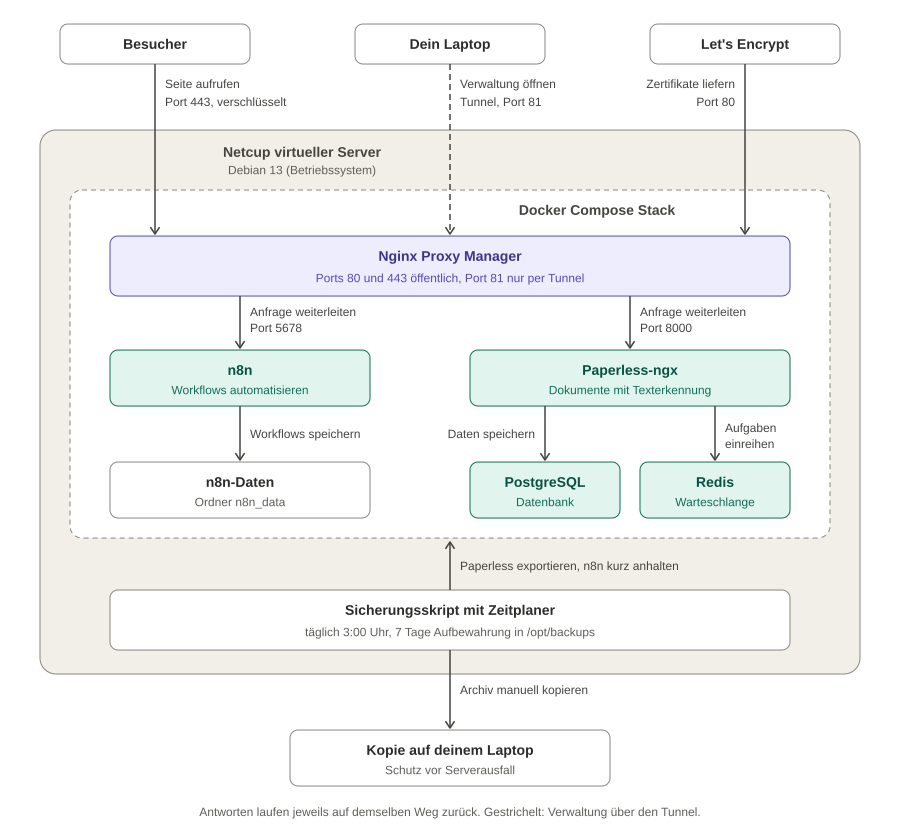

# Homeserver mit n8n und Paperless-ngx

Selbst betriebener Server auf einem virtuellen Server bei Netcup. Er stellt zwei Anwendungen bereit, die über eigene Unterseiten verschlüsselt erreichbar sind:

- **n8n** zum Automatisieren von Arbeitsabläufen
- **Paperless-ngx** als digitales Dokumentenarchiv mit Texterkennung

Das Projekt dokumentiert, wie ich den Server eingerichtet, abgesichert und gesichert habe, einschließlich der Fehler, die dabei aufgetreten sind.

## Architektur



Alle Anfragen laufen über einen einzigen Eingang, den Nginx Proxy Manager. Er nimmt verschlüsselte Verbindungen an, verwaltet die Zertifikate und leitet jede Anfrage an die passende Anwendung weiter. Die Anwendungen, die Datenbank und die Warteschlange sind von außen nicht direkt erreichbar.

## Verwendete Technik

| Bereich | Technik |
|---|---|
| Server | Virtueller Server bei Netcup, Debian 13 |
| Container | Docker und Docker Compose |
| Eingang und Verschlüsselung | Nginx Proxy Manager, Zertifikate von Let's Encrypt |
| Anwendungen | n8n, Paperless-ngx |
| Datenhaltung | PostgreSQL 16, Redis 7 |
| Automatisierung | Bash-Skript, Zeitplaner Cron |
| Zugriff | SSH mit Tunnel |

## Aufbau des Repositorys

```
.
├── docker-compose.yml   Beschreibung aller Container
├── .env.example         Vorlage für Passwörter und Schlüssel (ohne echte Werte)
├── .gitignore           schließt Geheimnisse und Daten vom Hochladen aus
├── scripts/
│   └── backup.sh        Sicherung der Anwendungsdaten
└── docs/
    └── architektur.svg  Architekturbild
```

## Sicherheit

- **Verwaltungsoberfläche nicht öffentlich:** Port 81 des Nginx Proxy Managers ist an `127.0.0.1` gebunden. Ich erreiche ihn nur über einen verschlüsselten SSH-Tunnel.
- **Nur zwei öffentliche Ports:** Port 80 (Zertifikatsprüfung und Umleitung) und Port 443 (verschlüsselter Zugriff).
- **Keine offenen Datenbankports:** PostgreSQL und Redis laufen nur im internen Docker-Netzwerk.
- **Geheimnisse getrennt:** Passwörter und Schlüssel stehen in einer `.env`-Datei auf dem Server. Die `docker-compose.yml` enthält nur Platzhalter. Die `.env` ist über `.gitignore` vom Hochladen ausgeschlossen.
- **Zertifikate automatisch:** Let's Encrypt stellt sie aus, der Nginx Proxy Manager erneuert sie.
- **Anonyme Absenderadresse:** Commits verwenden die anonyme E-Mail-Adresse von GitHub, nicht meine echte.

## Datensicherung

Das Skript `scripts/backup.sh` läuft täglich um 3:00 Uhr über Cron:

1. Paperless exportiert Dokumente, Schlagwörter und Benutzer in ein Verzeichnis.
2. n8n wird kurz angehalten, damit seine Datenbankdatei konsistent kopiert wird.
3. Der gesamte Stack-Ordner wird in ein Archiv gepackt (`/opt/backups`).
4. n8n startet wieder, Archive älter als sieben Tage werden gelöscht.

Eine Kopie des Archivs hole ich regelmäßig von Hand auf einen anderen Rechner, damit sie einen Serverausfall überlebt. Das Archiv enthält Passwörter und Schlüssel im Klartext und wird entsprechend geschützt aufbewahrt.

Die Sicherung ist betriebssystemunabhängig: Sie enthält nur Dateien, die sich auf jedem Linux mit Docker einspielen lassen.

**Wiederherstellung auf einem neuen Server:**

1. Docker installieren.
2. Archiv kopieren und entpacken: `tar -xzf anwendungsdaten_DATUM.tar.gz -C /opt`
3. Stack starten: `cd /opt/n8n-stack && docker compose up -d`
4. Warten, bis Paperless den Status `healthy` zeigt.
5. Paperless-Daten einlesen: `docker compose exec paperless document_importer ../export`
6. DNS-Einträge auf die neue Server-Adresse umstellen.

Eine vollständige Wiederherstellung auf einem Testserver steht noch aus.

## Probleme und Lösungen

Die ausführliche Beschreibung mit Diagnose steht in [docs/fehlersuche.md](docs/fehlersuche.md). Kurzfassung:

| Symptom | Ursache | Lösung |
|---|---|---|
| Fehler 502 Bad Gateway | n8n-Container stürzte beim Start ab: Datenordner gehörte `root`, n8n läuft als Benutzer 1000 | `chown -R 1000:1000 n8n_data` |
| Weiterleitung erreicht n8n nicht | `127.0.0.1` zeigt im Proxy-Container auf den Proxy selbst | Dienstnamen `n8n` als Ziel eintragen |
| Einstellungen von n8n wirken nicht | Tippfehler in Namen der Umgebungsvariablen werden ohne Fehlermeldung ignoriert | Namen gegen die Dokumentation prüfen |
| `docker compose` bricht mit YAML-Fehler ab | Beim Einfügen wurde ein Wort vor die erste Zeile kopiert | Datei per `cat > ... << 'EOF'` neu schreiben und mit `docker compose config` prüfen |
| Login zum Proxy Manager nicht möglich | Passwort vergessen | Passwort-Hash direkt in der SQLite-Datenbank ersetzt |

## Installation zum Nachbauen

Voraussetzungen: ein Linux-Server mit Docker und Docker Compose, eine eigene Domain mit zwei Unterseiten, die per A-Eintrag auf den Server zeigen.

1. Repository klonen und in den Ordner wechseln.
2. In der `docker-compose.yml` die Domain `frederik-scholze.de` durch die eigene ersetzen.
3. Zugangsdaten erzeugen:
   ```bash
   cp .env.example .env
   echo "PAPERLESS_DB_PASSWORD=$(openssl rand -hex 16)" > .env
   echo "PAPERLESS_SECRET_KEY=$(openssl rand -hex 32)" >> .env
   chmod 600 .env
   ```
4. Ordner anlegen und Rechte setzen:
   ```bash
   mkdir -p n8n_data paperless_data/consume paperless_data/export
   chown -R 1000:1000 n8n_data paperless_data
   ```
5. Stack starten: `docker compose up -d`
6. Paperless-Benutzer anlegen: `docker compose exec paperless python3 manage.py createsuperuser`
7. Die Verwaltungsoberfläche über einen Tunnel öffnen (`ssh -L 8181:127.0.0.1:81 benutzer@server`, dann `http://127.0.0.1:8181`) und je einen Proxy Host für n8n (Ziel `n8n`, Port 5678) und Paperless (Ziel `paperless`, Port 8000) mit Zertifikat und Websockets anlegen.
8. Sicherung einrichten: `scripts/backup.sh` nach `/opt/backup/` kopieren, ausführbar machen und per `crontab -e` einplanen.

## Was ich gelernt habe

- Fehler eingrenzen, indem man von außen nach innen prüft: Container-Status, Logs, dann Weiterleitung.
- Dateirechte zwischen Host und Container gehören zu den häufigsten Ursachen für Abstürze.
- Ein Zugang zur Verwaltung gehört nicht ins Internet. Ein Tunnel ist einfacher als gedacht.
- Geheimnisse und Konfiguration konsequent trennen, bevor etwas veröffentlicht wird.
- Eine Sicherung ist erst dann eine Sicherung, wenn sie auch an einem zweiten Ort liegt und die Wiederherstellung getestet wurde.

## Nächste Schritte

- Wiederherstellung auf einem Testserver durchspielen und dokumentieren
- Kopie der Sicherung automatisieren
- Versionen der Container festlegen, statt `latest` zu verwenden
